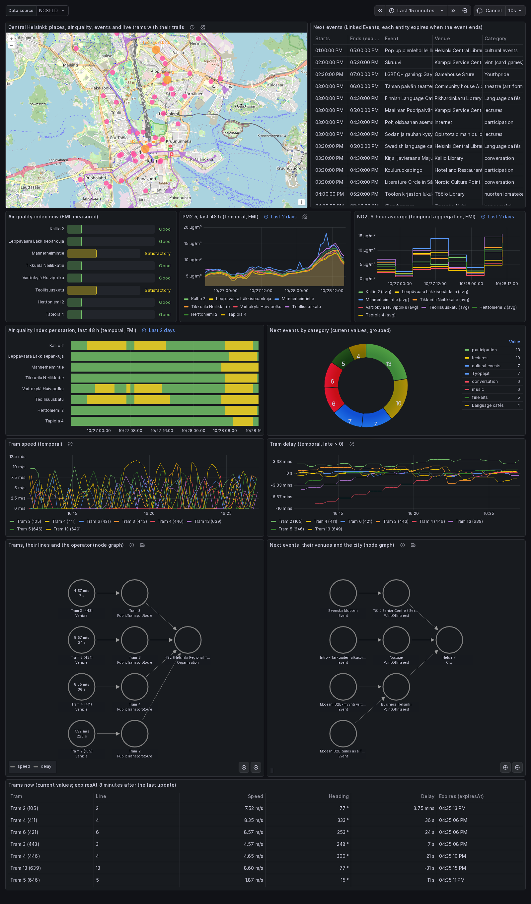
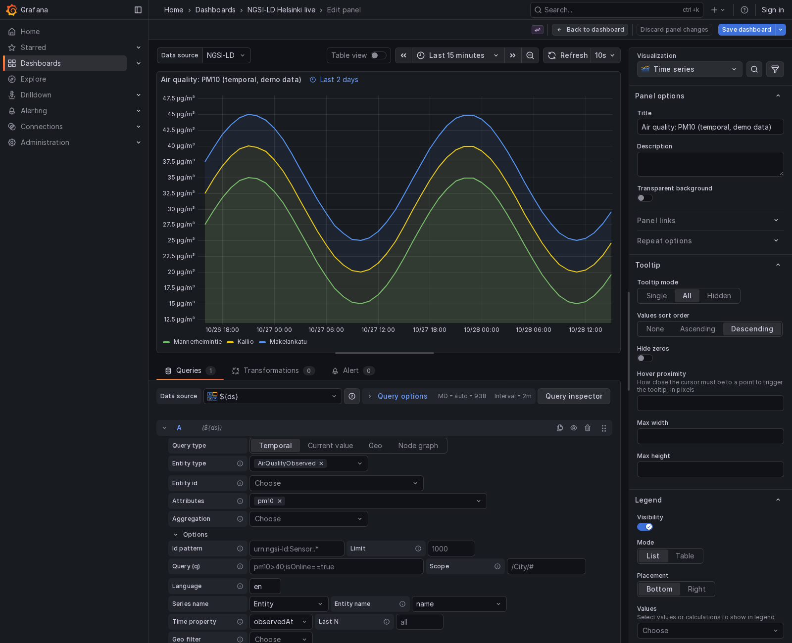
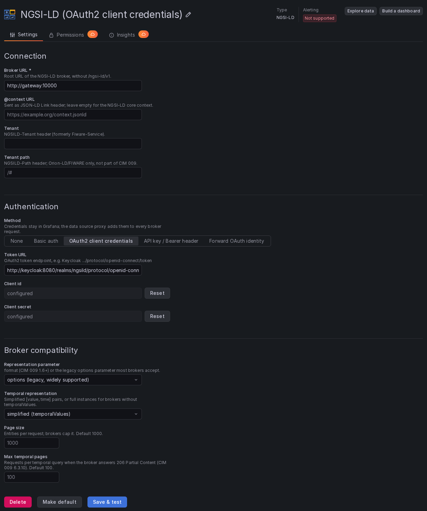

# NGSI-LD data source for Grafana

Grafana data source plugin for NGSI-LD context brokers (ETSI GS CIM 009): current values, temporal history
and aggregation, geo-queries and relationship graphs. Fork of
[bfi-de/ngsild-grafana-datasource](https://github.com/bfi-de/ngsild-grafana-datasource), rewritten for
Grafana 12.3+ and tested against the [Antares](https://antaresbroker.joinedcontext.com) broker.

Configuration, query types and variables: [datasource/plugin/README.md](datasource/plugin/README.md).
Changes: [datasource/plugin/CHANGELOG.md](datasource/plugin/CHANGELOG.md).

## Run the demo

You need [Docker Desktop](https://www.docker.com/products/docker-desktop/) (Windows, macOS) or Docker with
the Compose plugin (Linux), and git. Nothing else: Node, Grafana and the broker all run in containers.

1. Start Docker Desktop and wait until it says *Engine running*.
2. Get the code and start the demo:

   ```bash
   git clone https://github.com/joinedcontext/Grafana-NGSI-LD-data-source.git
   cd Grafana-NGSI-LD-data-source/demos/helsinki
   docker compose up -d
   ```

3. Wait about a minute. The first start downloads the images, and Grafana installs the plugin from the
   newest [release](https://github.com/joinedcontext/Grafana-NGSI-LD-data-source/releases/latest). Later
   starts take seconds. `docker compose ps` shows `antares`, `air`, `hsl`, `events` and `grafana` as *Up* and
   `seed` as *Exited (0)* when the demo is ready.
4. Open http://localhost:3000. No login: the Helsinki dashboard is the home page.
5. Stop it with `docker compose down` in the same folder. `docker compose up -d` starts it again with
   fresh air quality history.

What you should see: a map of central Helsinki with parks, buildings, Mannerheimintie, the FMI air quality
stations, the venues of the next events and live trams with their trails; measured air quality for the
last two days; the next events as a table and by category; tram speed, delay and a table of the trams in
service; node graphs of the trams and their lines, and of the events, venues and the city. The tram charts
fill in over the first minutes. Everything else about the demo: [demos/helsinki/README.md](demos/helsinki/README.md).

| Problem | Fix |
|---|---|
| `port is already allocated` | another program uses port 3000 or 9090: `GRAFANA_PORT=3001 BROKER_PORT=9091 docker compose up -d` (PowerShell: create a file `.env` in `demos/helsinki` with the lines `GRAFANA_PORT=3001` and `BROKER_PORT=9091`) |
| `Cannot connect to the Docker daemon` / `pipe/dockerDesktopLinuxEngine` | Docker Desktop is not running yet |
| No trams, events or air quality | the feeds need internet: `docker compose logs air hsl events` |
| Air quality history has a gap | the demo was stopped for a while: `docker compose restart air` writes fresh history |
| Demo with a fixed plugin version | `NGSILD_PLUGIN_URL=https://github.com/joinedcontext/Grafana-NGSI-LD-data-source/releases/download/v8.0.0/ngsild-grafana-datasource.zip docker compose up -d` |



| Query editor | Configuration |
|---|---|
|  |  |

## Development and test stack

```bash
cd datasource
docker compose up -d     # Antares, sample data, Grafana with the plugin and the sample dashboard
```

http://localhost:3000 opens the sample dashboard, which shows every query type. This stack builds the
plugin from the source in `datasource/plugin` (the demo uses the release); after a change,
`docker compose up -d --build` rebuilds it. The integration and end-to-end tests run against this
stack.

| Service | Purpose |
|---|---|
| `antares` | `ghcr.io/joinedcontext/antares-broker`, NGSI-LD API on http://localhost:9090/ngsi-ld/v1 |
| `seed` | Runs `seed/seed.mjs` on every `up`: three Helsinki air quality stations with 48 h of hourly history ending now, devices, City Hall with a multi-instance attribute, a road, a zone and two parks (OpenStreetMap shapes), relationships between them. `docker compose run --rm seed` refreshes the history |
| `grafana` | Grafana built from `plugin/Dockerfile` with the plugin, the provisioned data source and the sample dashboard |

The stack logs everyone in to Grafana as admin and Antares authenticates nobody, so every port binds to
127.0.0.1. `BIND_ADDRESS=0.0.0.0` in `datasource/.env` publishes them on every interface; do that only on a
trusted network.

To use another broker, copy `datasource/.env.example` to `datasource/.env` and set `BROKER_URL` and the
other values there. Compose reads that file on every start, so the stack only shows the bundled Antares
while `datasource/.env` sets no `BROKER_URL`. `GRAFANA_VERSION` picks the Grafana release (tested: 12.3.0,
the default, and 13.2.4). `docker compose down` stops the stack.

### With authentication and authorization

```bash
docker compose -f docker-compose.yml -f docker-compose.auth.yml up -d
```

adds Keycloak (http://localhost:8080, admin/admin) and an Envoy gateway in front of Antares. The gateway
plays the part of a production gateway, since Antares itself authenticates nobody:

| Gateway listener (compose network; 10000 also on the host) | Accepts |
|---|---|
| 10000 | a Keycloak access token with the realm role `ngsi-ld-reader`, `GET` and `HEAD` only |
| 10001 | basic auth `grafana` / `grafana-basic-pw` |
| 10002 | header `X-API-Key: demo-api-key-0123456789abcdef` |

Grafana then needs a sign-in: `admin`/`admin`, or *Sign in with Keycloak* as `alice`/`alice` (has
`ngsi-ld-reader`) or `bob`/`bob` (has not). It provisions one data source per authentication mode and
the cases the gateway refuses: no credentials, a wrong secret, a client without the role, a wrong
password, a wrong key. Every listener of the gateway accepts `GET` and `HEAD` only. The data source
*NGSI-LD (forwarded OAuth identity)* sends the signed-in user's token: alice reads, bob gets
`403 RBAC: access denied`. All credentials in `datasource/auth/` are demo values.

Only the forwarded identity decides per user. The data sources with shared credentials (OAuth2 client,
basic auth, API key) and the unauthenticated *NGSI-LD* data source read for everyone who may query them,
bob included. To enforce per-user access in your own Grafana, provision only forwarded-identity data
sources, or restrict the others with Grafana's data source permissions.

## Install in an existing Grafana

Every release on GitHub carries the plugin as `ngsild-grafana-datasource.zip`, with its SHA-256 next to it.
The newest release is always at
`https://github.com/joinedcontext/Grafana-NGSI-LD-data-source/releases/latest/download/ngsild-grafana-datasource.zip`, a fixed one at
`.../releases/download/v<version>/ngsild-grafana-datasource.zip`.

```bash
grafana cli --pluginUrl https://github.com/joinedcontext/Grafana-NGSI-LD-data-source/releases/latest/download/ngsild-grafana-datasource.zip \
  plugins install ngsild-grafana-datasource
```

In Docker, set `GF_PLUGINS_PREINSTALL=ngsild-grafana-datasource@@<zip URL>` instead. The release zip is
unsigned unless the repository has the `GRAFANA_ACCESS_POLICY_TOKEN` secret, so Grafana needs
`GF_PLUGINS_ALLOW_LOADING_UNSIGNED_PLUGINS=ngsild-grafana-datasource`. Restart Grafana and add the data
source under *Connections > Data sources*.

Without a release: `datasource/build.sh` builds `datasource/plugin/dist` in Docker (the build stage of
`plugin/Dockerfile`, no local Node); copy `dist` to the Grafana plugin directory as
`ngsild-grafana-datasource`.

## Releases

`.github/workflows/build.yml` runs typecheck, lint, unit tests, integration tests against Antares, the
HSL feed tests and the end-to-end suite on Grafana 12.3.0 and 13.2.4 for every push and pull request.

To release, raise `version` in `datasource/plugin/package.json` (and add the entry to `CHANGELOG.md`) and
push to `main`. When no tag `v<version>` exists yet and every check passes, the workflow builds the zip,
stamps the version and date into `plugin.json`, signs it when the `GRAFANA_ACCESS_POLICY_TOKEN` secret is
set, creates the tag and publishes the GitHub release. Pushing a `v*` tag does the same for that tag; the
tag has to match the version in `package.json`. *Run workflow* with `release_tag` rebuilds an existing
tag. `.gitlab-ci.yml` runs the unit checks and builds the zip as a job artifact.

## Development

In `datasource/plugin`, with Node 22:

```bash
npm ci
npm run dev              # watch build into dist/
npm run typecheck
npm run lint
npm run test:ci          # unit tests
npm run build            # production build
```

Integration and end-to-end tests need the development stack (`docker compose up -d` in `datasource/`):

```bash
NGSILD_BROKER_URL=http://localhost:9090 npm run test:integration   # data source against Antares, own tenant
npx playwright install chromium
GRAFANA_URL=http://localhost:3000 npm run e2e                     # config page, editor, dashboard in Grafana
NGSILD_AUTH=1 GRAFANA_URL=http://localhost:3000 npm run e2e       # with the auth stack: also every auth mode
```

| Suite | Location | Covers |
|---|---|---|
| Unit | `src/**/*.test.ts(x)` | request building, frame conversion, paging against a fake broker, editors |
| Integration | `tests/integration` | every query type, paging, variables and errors over HTTP against a running broker |
| End-to-end | `tests/e2e` | Save & test, query editor, the sample dashboard in a real Grafana; with `NGSILD_AUTH=1` each authentication mode, the refused cases, read-only enforcement and per-user access through Keycloak sign-in |

The end-to-end suite passes on Grafana 12.3.0 and 13.2.4 (`GRAFANA_VERSION`). Every suite runs against
Antares; the plugin is not tested with other NGSI-LD brokers.

### Layout

```
datasource/
  plugin/       plugin source (src/), tests, Grafana build config (.config/)
  seed/         sample data loader, shared with the demo
  volumes/      Grafana provisioning of the development stack: data source, sample dashboard
  auth/         Keycloak realm, gateway rules, data sources of the auth stack
demos/
  helsinki/     Helsinki demo: compose file, dashboard, live open data feeds (feeds/)
screenshots/    images for this README
```

## Broker notes

- The plugin sends the CIM 009 1.9 `format` parameter and reads temporal history as `temporalValues`
  (`aggregatedValues` with an aggregation), with the temporal API under the same broker URL.
- `/entities` needs a type, attrs, q or georel (CIM 009 6.4.3.2) and `/temporal/entities` a type or attrs
  (6.18.3.2), unless the query is local. A query without them, for example one that selects only by
  entity id or id pattern, is sent with `local=true`; Antares enforces the rule.
- Entity queries ask for the total with `count=true` (`NGSILD-Results-Count`). Antares answers at most 1000
  entities per request; Save & test checks that the broker accepts the *Page size*.
- Brokers cut long temporal answers (`206 Partial Content`). The plugin continues them; *Max temporal
  pages* bounds the requests per query. A broker that serves more instances per answer needs fewer
  requests: Antares reads `ANTARES_TEMPORAL_INSTANCE_LIMIT` and `ANTARES_TEMPORAL_DEFAULT_INSTANCES`; the
  current `antares-broker:latest` image cuts at 9 instances per attribute.

## License

Apache 2.0, see [LICENSE](LICENSE).
